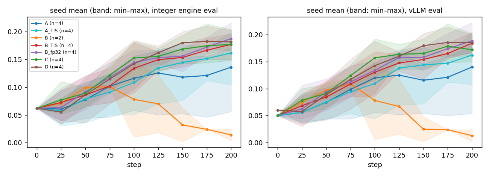
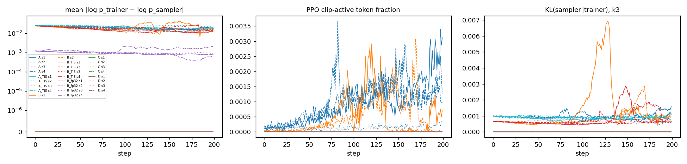
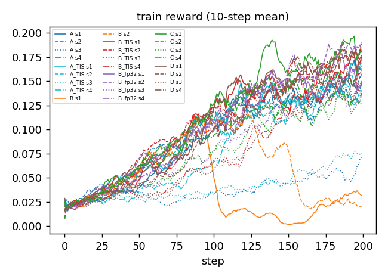
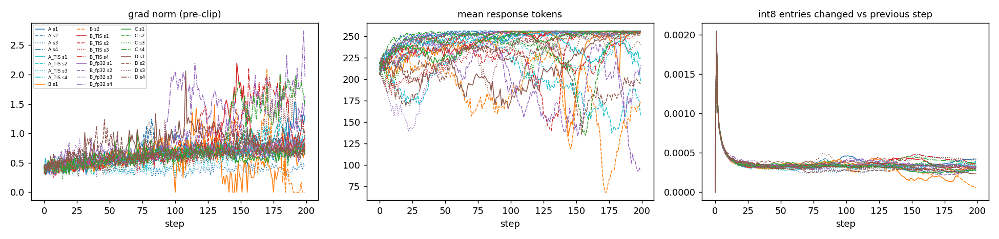

# A/B/C/D GRPO: does the arithmetic behind sampler and trainer log p change RL?

Question 3 of the A/B/C design (`2026-11-03-int-vs-float-train-infer-abc.md`): with the same quantized
weights at every step, train Llama-3.2-1B on GSM8K with GRPO under arms that differ only in which arithmetic
produces the sampler log p and the trainer log p. Arm D adds vLLM's own bitwise train/inference consistency
(batch-invariant mode) as the float counterpart of C.

| arm | sampler (rollouts, sampler log p) | trainer log p used in the ratio | gradient |
|---|---|---|---|
| A | vLLM 0.32 bf16 | HF bf16 | HF bf16 graph |
| A_TIS | vLLM 0.32 bf16 | HF bf16, plus truncated IS weight min(π_train/π_sampler, 2) | HF bf16 graph |
| B | BitExact int8 engine | HF bf16 | HF bf16 graph |
| B_TIS | BitExact int8 engine | HF bf16, plus the A_TIS weight | HF bf16 graph |
| B_fp32 | BitExact int8 engine | HF fp32 (TF32 off) | HF fp32 graph |
| C | BitExact int8 engine | BitExact int8 engine (teacher-forced rescoring) | HF bf16 graph, logp_hf + sg(logp_int − logp_hf) |
| D | vLLM 0.32 bf16, `VLLM_BATCH_INVARIANT=1`, TRITON_ATTN | the same vLLM engine, teacher-forced (`prompt_logprobs`) | HF bf16 graph, logp_hf + sg(logp_vllm − logp_hf) |

## Results (4 seeds × 200 steps per arm; B: 2 seeds)



Per-seed curves: `figs/eval_seeds.png`.

GSM8K test (first 500, greedy, 2-shot, 256 tokens), at step 0: integer engine 0.062, vLLM 0.050 (D's
batch-invariant vLLM: 0.060). Values are mean ± SD over seeds [min, max]. Collapsed = final accuracy below half
of the run's best evaluation.

| arm | n | int engine acc, step 200 | vLLM acc, step 200 | int acc, mean of steps 150-200 | train reward, last 20 steps | collapsed runs |
|---|---|---|---|---|---|---|
| A | 4 | 0.136 ± 0.054 [0.056, 0.170] | 0.140 ± 0.058 [0.054, 0.180] | 0.125 ± 0.049 [0.051, 0.152] | 0.129 ± 0.046 [0.060, 0.159] | 0/4 |
| A_TIS | 4 | 0.162 ± 0.040 [0.104, 0.198] | 0.162 ± 0.040 [0.108, 0.204] | 0.152 ± 0.037 [0.097, 0.179] | 0.132 ± 0.040 [0.074, 0.160] | 0/4 |
| B | 2 | 0.014 ± 0.014 [0.004, 0.024] | 0.013 ± 0.016 [0.002, 0.024] | 0.023 ± 0.019 [0.010, 0.037] | 0.027 ± 0.006 [0.023, 0.032] | 2/2 |
| B_TIS | 4 | 0.177 ± 0.023 [0.150, 0.196] | 0.184 ± 0.016 [0.168, 0.204] | 0.166 ± 0.016 [0.149, 0.185] | 0.162 ± 0.019 [0.139, 0.183] | 0/4 |
| B_fp32 | 4 | 0.188 ± 0.021 [0.170, 0.216] | 0.189 ± 0.026 [0.162, 0.222] | 0.172 ± 0.018 [0.154, 0.195] | 0.158 ± 0.021 [0.133, 0.182] | 0/4 |
| C | 4 | 0.177 ± 0.024 [0.148, 0.204] | 0.172 ± 0.025 [0.150, 0.202] | 0.173 ± 0.024 [0.151, 0.204] | 0.153 ± 0.026 [0.130, 0.185] | 0/4 |
| D | 4 | 0.181 ± 0.015 [0.166, 0.202] | 0.185 ± 0.016 [0.166, 0.200] | 0.181 ± 0.016 [0.166, 0.203] | 0.166 ± 0.017 [0.146, 0.185] | 0/4 |

Findings:

1. **B (integer sampler, bf16 trainer, no correction) collapsed in 2/2 seeds. No other run collapsed (0/24).**
   Adding TIS (B_TIS, 0/4) or computing the trainer in fp32 (B_fp32, 0/4) removed the collapse.
2. **C and D: no accuracy difference detected.** Both remove the sampler/trainer gap exactly (0 of all tokens
   at every step). D 0.181 ± 0.015, C 0.177 ± 0.024 at step 200.
3. **Accuracy among the arms that did not collapse: differences not detected.** Final means range from 0.136 (A)
   to 0.188 (B_fp32). The seed SD is 0.015–0.054; one A seed (s3) and one A_TIS seed (s3) barely learned (0.056,
   0.104), which drives the lower A / A_TIS means. A 500-question evaluation alone has a binomial SE of ~0.017.
4. Integer and float evaluations of the same weights agree within ~0.02 in every run.





Sampler vs trainer mismatch over all steps of all seeds (Δ = log p_trainer − log p_sampler on sampled tokens;
for C and D the trainer value is the integer / vLLM rescoring):

| arm | steps | mean \|Δ\| | max \|Δ\| | tokens Δ≠0 | ratio outside [0.8,1.2] | clip-active | KL k3 | grad norm max | non-finite grads | bound errors |
|---|---|---|---|---|---|---|---|---|---|---|
| A | 800 | 1.93e-02 | 4.17 | 0.9929 | 5.22e-03 | 7.66e-04 | 9.06e-04 | 1.532 | 0 | 0 |
| A_TIS | 800 | 2.08e-02 | 5.22 | 0.9974 | 4.41e-03 | 0.00e+00 | 9.11e-04 | 1.269 | 0 | 0 |
| B | 400 | 1.94e-02 | 5.13 | 0.9997 | 7.54e-03 | 4.73e-04 | 1.10e-03 | 2.096 | 0 | 0 |
| B_TIS | 800 | 1.78e-02 | 3.98 | 1.0000 | 3.71e-03 | 0.00e+00 | 6.93e-04 | 2.196 | 0 | 0 |
| B_fp32 | 800 | 1.07e-03 | 0.934 | 1.0000 | 6.30e-07 | 1.28e-07 | 3.80e-06 | 2.741 | 0 | 0 |
| C | 800 | 0.00e+00 | 0 | 0.0000 | 0.00e+00 | 0.00e+00 | 0.00e+00 | 2.017 | 0 | 0 |
| D | 800 | 0.00e+00 | 0 | 0.0000 | 0.00e+00 | 0.00e+00 | 0.00e+00 | 2.059 | 0 | 0 |

(A_TIS, B_TIS: the PPO ratio is π_train/sg(π_train) = 1 and the mismatch enters only through the truncated
weight, so the clip-active share is 0 by construction.)

## Why B collapses: evidence

What the runs show (no mechanism experiment was run):

- **Timing.** B learned like the other arms until step ~75 (eval 0.098 / 0.104), then fell to 0.010 (seed 1,
  step 100) and 0.062 (seed 2, step 150), then about 0.02 for the rest of the run. The vLLM evaluation of the same
  weights fell as well (0.002 / 0.024), so the weights degraded; the integer engine's evaluation did not
  hide or cause it.
- **The ratio drifted before the collapse.** In B, the share of tokens with π_bf16/π_int outside [0.8, 1.2] rose
  from 7e-4 (steps 0–39) to 1.9e-2 (seed 1, steps 80–159) and 1.1–1.3e-2 (seed 2, steps 120–199). The same
  share rose in A (2.5e-3 → 0.7–1.1e-2) and B_TIS (7e-4 → 0.4–1.4e-2) without collapse, so drift alone does
  not separate collapsing from non-collapsing runs at this sample size.
- **Correcting the gap removes the collapse.** B_TIS uses the same samples and the same bf16 trainer as B; the
  only change is that the gap enters as a truncated importance weight instead of the PPO ratio. 0/4 collapsed.
- **Shrinking the gap removes the collapse.** With an fp32 trainer, the gap to the integer sampler is 18× smaller
  (mean |Δ| 1.1e-3 vs 1.9e-2; ratio outside [0.8, 1.2] 6.3e-7 vs 7.5e-3). 0/4 collapsed. The int8 engine
  is closer to fp32 than bf16 is.
- **A, whose gap is the same size as B's (mean |Δ| 1.9e-2), did not collapse (0/4).** The size of the gap is
  therefore not sufficient. What differs between A and B was not isolated. Two candidates, neither tested:
  in B the sampler and the trainer run different arithmetic over the whole forward pass (int8 activations vs
  bf16), while in A both are bf16 and differ in kernels; and B's early-training ratio is closer to 1 (7e-4
  vs 2.5e-3 outside the clip), so less of it is clipped.
- With 2 B seeds the collapse rate is 2/2; its frequency is not established.

## C vs D

Both arms make the trainer's log p values bitwise equal to the sampler's. C does it with integer arithmetic
(BitExact int8), D with vLLM's batch-invariant float kernels and vLLM itself as the scorer, following vLLM's
train/inference consistency recipe (blog post 2026-10-14, skill vllm-project/vllm#61551: the training forward
gets its values from the inference kernels, and the gradient comes from a separate graph, `visible + (graph −
graph.detach())`).

| | C (integer) | D (vLLM batch-invariant) |
|---|---|---|
| sampler vs trainer log p, all tokens of all steps (4 seeds × 200 steps) | 0 differ | 0 differ |
| GSM8K at step 200, integer-engine eval | 0.177 ± 0.024 | 0.181 ± 0.015 |
| GSM8K at step 200, vLLM eval | 0.172 ± 0.025 | 0.185 ± 0.016 |
| collapsed runs | 0/4 | 0/4 |
| max grad norm (pre-clip) | 2.02 | 2.06 |
| s/step, median (sample / rescoring / trainer) | 30.9 (16.3 / 9.1 / 5.3), H100 | 16.5 (7.1 / 4.0 / 5.3), H800 |
| HF graph vs scorer value, mean \|Δ\| (what the surrogate corrects) | 1.8e-2 | 2.0e-2 |
| 512 rollouts from step 0, rescored in batches of 512 / 37 / 1 | 0 differ (bs 16 vs 3) | 0 differ |
| H800 → H100: rescored log p of the same 108,654 tokens | 0 differ | 0 differ |
| H800 → H100: rollouts resampled with the same seeds | 1,007/1,007 token-identical (rl_mismatch plugin replay) | 512/512 token-identical, log p 0 differ |

The accuracy difference between C and D was not detected. D was about 1.9× faster per step, but it ran on H800
(141) and C on H100 (138), both with other users' jobs on the hosts, so the speed ratio is approximate.

**D only holds with a non-default attention backend.** With vLLM's default FLASH_ATTN (same
`VLLM_BATCH_INVARIANT=1`, H800), the step-0 check failed:

- sampler (decode) vs scorer (prefill): 108,198 of 108,730 tokens differ, mean |Δ| 0.026, max 10.4;
- scorer in one batch of 512 vs chunks of 37: 302 tokens differ;
- with prefix caching on, decoding a request alone vs in a batch of 16 gives different log p from the first
  token (3/4 sampled sequences diverged within 80 tokens). With prefix caching off, decode was batch-invariant
  but still differed from the prefill path.

With `TRITON_ATTN` (one kernel for prefill and decode) all of these differences are 0, with prefix caching on
or off. FLEX_ATTENTION also gave 0 on the 16-sequence check. All D runs use TRITON_ATTN.

**Cross-hardware scope.** The H800 → H100 check used vLLM 0.32.0 and torch 2.13 on both hosts (cu129 / driver
535 vs cu130 / driver 595), both Hopper. D's identity across these two hosts holds for this pair; it relies on
the same Triton kernels being chosen on both, and was not tested on other architectures or library versions.
C's integer results are identical across H800, H100 and x86 CPU in the earlier rl_mismatch runs, and on CPU they
do not use GPU kernels at all.

## Can the int8 constants be rebuilt every step?

Yes. Each step quantizes the fp32 master to a fresh int8 constants set: per-row int8 weights, multipliers
m_c and the per-matrix exponent fm are recomputed by the BitExact builder's rule
(fm = min(60, ⌊62 − log2(worst)⌋ − 1), which keeps |acc·m| < 2^62 for any activation within limbs);
RMSNorm gammas are rounded at 12 bits; tables (exp, SiLU, RoPE, ln) do not depend on weights and are reused.

- The per-step quantizer reproduces the original constants file bit for bit at step 0 (`check_setup.py`,
  CHECK1). A first version computed the scales on the GPU, where CUDA turns w / s into w · (1/s): ~1e-4 of
  the weights rounded differently. Scales and multipliers are now computed on the CPU.
- fm stayed in 29..32 for every step of every run. 0.2% of int8 entries changed at step 1 and 0.01–0.04% per
  step at the end, at lr 1e-6.
- The engine's device-side bound checks (`model.check()`) passed for every integer forward of every run
  (sampling, rescoring and evaluation): 0 bound errors. These are runtime guards, not a static proof for all
  inputs.

## Setup

- Model Llama-3.2-1B (base, unsloth mirror). fp32 master weights (tied embedding), AdamW (β 0.9/0.999,
  wd 0), lr 1e-6 constant, grad-norm clip 1.0.
- GRPO: 64 GSM8K-train prompts per step × G = 8, T = 1, no top-k/top-p, ≤ 256 new tokens, stop at EOS. 2-shot
  prompt (train examples 0 and 1, excluded from training). Reward 1 iff `#### N` in the text before the first
  `\nQuestion:` equals the gold answer. Advantages normalized per group ((r − mean)/(std + 1e-4)). Token-mean
  loss over the 512 responses, one optimizer step per RL step (gradient accumulation over microbatches of
  16; B_fp32: 4). PPO clip ε = 0.2. No reference-model KL (β = 0); the logged KL is sampler vs trainer.
- Same prompts and request seeds per step across arms for a given seed (seed s: prompt order from
  `random.Random(s)`).
- Weights every step: int8 quantization of the master. Float arms load the dequantized values
  (q · m_c · 127 / 2^fm, gammas and embedding at the engine's fixed point; lm_head = dequantized int8
  embedding, untied) in bf16 into both vLLM (in-process `load_weights`, prefix cache reset) and the HF
  trainer. Straight-through gradient: master grad = grad w.r.t. the dequantized weights (embedding and
  lm_head grads summed for the tied master).
- Integer sampler: standalone `bitexact.int8` engine (batched prefill + KV-cache decode, Gumbel-max keyed by
  (request seed, t) with the vLLM plugin's GPU PCG64). It matches the plugin: 16/16 rollouts of the
  rl_mismatch plugin run reproduced token for token (CHECK3).
- Integer log p (`intq.int_logp`): integer log-softmax of the int64 logits row (44-bit exp table with
  rounded interpolation, the engine's ln table); within 5e-9 of a float64 log-softmax and batch-invariant.
- D: one in-process vLLM engine with `VLLM_BATCH_INVARIANT=1` and `attention_config={"backend":
  "TRITON_ATTN"}` serves both sampling (`logprobs=0`, raw log p) and scoring (`prompt_logprobs=0` on
  prompt + response, all 512 sequences in one call). Batch-invariant mode also patches torch matmuls in the
  process, so D's HF trainer graph runs on those kernels too. Step-0 check: `check_d.py`.
- Eval every 25 steps and at the end: GSM8K test first 500, greedy, both the integer engine and vLLM with the
  current weights (D: its batch-invariant vLLM).
- Hardware: A, A_TIS, B, B_TIS, C and B_fp32 seeds 1–2 on 8× H100 80GB (host 138, driver 595, torch 2.13 +
  cu130); D and B_fp32 seeds 3–4 on H800 (host 141, driver 535, torch 2.13 + cu129). vLLM 0.32.0,
  transformers 5.19 on both. One run per GPU; GPUs were shared with other users' jobs, so timings are under
  load.

## Cost

| arm | s/step (median) | sample | int rescoring | trainer fwd+bwd | quantize+sync | peak mem GB |
|---|---|---|---|---|---|---|
| A | 10.9 | 5.3 | 0.0 | 5.3 | 0.12 | 73.9 |
| A_TIS | 10.5 | 5.1 | 0.0 | 5.2 | 0.12 | 73.9 |
| B | 21.4 | 16.1 | 0.0 | 5.0 | 0.12 | 73.9 |
| B_TIS | 21.6 | 16.1 | 0.0 | 5.3 | 0.12 | 73.9 |
| B_fp32 | 55.6 | 16.3 | 0.0 | 39.0 | 0.14 | 63.2 |
| C | 30.9 | 16.3 | 9.1 | 5.3 | 0.12 | 73.9 |
| D | 16.5 | 7.1 | 4.0 | 5.3 | 0.15 | 73.6 |

Median over all steps of all seeds; C, A, A_TIS, B, B_TIS on H100, D on H800, B_fp32 on both.

Pilot (10 steps, 1 GPU each): A 10.3, A_TIS 10.0, B 21.4, C 29.8 s/step. Peak memory includes vLLM's in-process
reservation (gpu_memory_utilization 0.18). B_fp32's trainer runs at 4 sequences per microbatch (16 ran out of
memory), which makes it the slowest arm. Evaluation of 500 greedy questions: integer engine ~14 s, vLLM ~2.8 s.

## Deviations from the design

- The integer sampler is the standalone engine, not the vLLM plugin: the plugin loads constants at start-up,
  while RL swaps weights every step. Token identity with the plugin was checked (above).
- D is a small-scale analog of vLLM's recipe. The recipe's trainer calls vLLM kernels directly inside a
  training framework; here the scorer is a full vLLM teacher-forced pass in the same process, and the
  gradient comes from HF.
- The original-bf16-model A reference row was not run.
- No reference-model KL (allowed by the task: "optional/small").
- Failed launches, all restarted from scratch with logs kept on the hosts: C s1 and B s1 (GPU memory taken by
  other jobs); B_fp32 s1–s4 at microbatch 16 (OOM, rerun at 4); B_fp32 s4 on 141 (vLLM memory profiling
  assertion while another job released memory); one duplicate B_TIS s3 launch, killed and discarded.

## Scope

- One model, one task, 200 steps, 4 seeds per arm (B: 2). Accuracy differences of a few points are within
  seed noise here.
- B's collapse is 2/2; the cause is not isolated (see above).
- The PPO ratio here only measures arithmetic mismatch (one optimizer step per batch), so these results are
  about mismatch, not about multi-epoch PPO.
- The float arms use the dequantized int8 weights in bf16; results for a stock bf16 model may differ.
- D's and C's cross-hardware checks cover H800 and H100 (plus CPU for C, from rl_mismatch).

## Reproduce

```
# on a GPU host; env: PY (vLLM 0.32 venv with this repo on PYTHONPATH), HF (Llama-3.2-1B dir),
# CONST (int8 constants from examples/build_constants.py), DATA (GSM8K train/test jsonl), C (this dir)
$PY $C/check_setup.py --hf $HF --const $CONST --data $DATA --rollout PLUGIN_ROLLOUT.json
$PY $C/check_d.py --hf $HF --const $CONST --data $DATA --work work --out d_hostA.json
$PY $C/check_d.py ... --ref d_hostA.json --out d_hostB.json          # on a second GPU type
OUT=runs bash $C/run_full.sh "0:C_s1" "1:D_s1" "2:A_s1,A_TIS_s1" "3:B_TIS_s1" ...   # GPU:run[,run]
# B_fp32: add --mb 4 (train.py)
python $C/analyze.py --runs runs --out figs
```

Files: `intq.py` (per-step quantization, integer engine wrapper, integer log p, batched integer sampling and
scoring), `floatm.py` (vLLM sampler / scorer with weight sync, HF trainer with straight-through),
`train.py` (GRPO, all arms), `check_setup.py`, `check_d.py`, `run_full.sh`, `analyze.py`.
